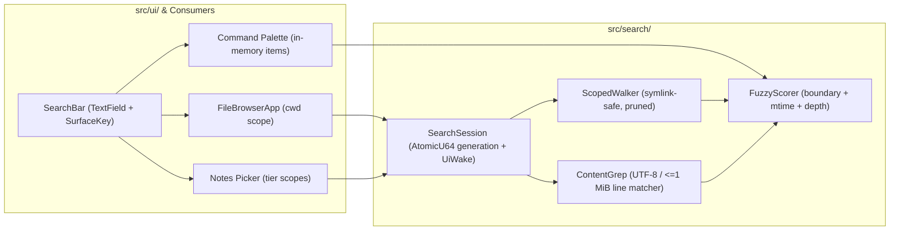

Stint: 0814
Status: active

# Unified Host Search Primitive (`src/search/` + `src/ui/search_bar.rs`)

Instead of bolting recursive directory walking, content grep, fuzzy ranking, and a bespoke search input exclusively onto `FileBrowserApp`, Plexi should swim upstream once and establish a single **Host Search Primitive**.

Today, search across the Rust host is fragmented across four independent, incompatible implementations—each with its own directory prune list, string matcher, keyboard-focus quirks, and threading model. Consolidating them into `src/search/` (engine) and `src/ui/search_bar.rs` (chrome) eliminates an entire class of UI freezes, key-routing footguns, and ranking inconsistencies while giving File Explorer, Notes Picker, Command Palette, and agent/CLI tools one fast, recency-aware search engine.

---

## 1. Why Swimming Upstream Pays Off: The Four Current Silos

| Surface | Current Location | What It Does Today | The Footguns |
|---|---|---|---|
| **File Explorer** | `FileBrowserApp::draw_search_bar`, `filter_entries` | Flat, single-directory `contains()` filter over `self.entries`. | **Fake input widget:** `draw_search_bar` paints static `colored_label`s instead of a `TextField` with `SurfaceKey`. No blinking caret, no `Cmd+V` paste, no `Alt+Backspace` word-delete, no text selection, and manual key interception in `classify_key`. Cannot see into subfolders or file contents. |
| **Notes Picker** | `notes_picker_filtered`, `fuzzy_match`, `NOTES_WALK_PRUNE`, `NotesIndexCache` | Tiered directory walk (`nested_tiers_below`) + 3-bucket rank (`title.contains`, `fuzzy_match(title)`, `fuzzy_match(body)`). | `fuzzy_match` is a boolean character-subsequence check with **zero gap penalty or boundary scoring**—`"abc"` matches `"a_very_long_b_string_c"` with the exact same score as `"abc"`. Owns its own prune list (`NOTES_WALK_PRUNE`). |
| **Command Palette** | `PaletteEntry::query_rank`, `PaletteEntry::matches_query` | Strict substring `search_text.contains(query)` ranked by prefix / word-prefix / offset. | **No fuzzy matching at all** (a single typo or abbreviation like `"fbr"` for File Browser or `"wcfg"` for Workspace Config returns nothing) and no recency tie-breaking. |
| **Assistant / Host Tools** | `walk_scoped_files`, `grep_scoped`, `is_skipped_walk_dir` | Synchronous depth-first walk + `regex` line scan. | Duplicates directory pruning (`is_skipped_walk_dir` vs. `NOTES_WALK_PRUNE`), allocates and sorts all paths upfront before scanning, and has no streaming or cancellation handle for interactive UI callers. |

Every time we touch search in one surface, the others stay broken. Building the primitive upstream fixes all four.

---

## 2. Architecture Overview

The primitive splits cleanly into two layers that obey Plexi's existing `src/host/` + `src/ui/` boundaries:

1. **`src/search/` (Host Search Engine)** — Pure Rust, UI-agnostic, testable without `egui`:
   - **`ScopedWalker`**: One canonical directory walker and prune policy (`DEFAULT_PRUNE_DIRS`), symlink-safe, budget-capped, and cancellation-aware.
   - **`FuzzyScorer` (`score_candidate`)**: One deterministic fuzzy + word-boundary + recency (`mtime`) + depth scorer that returns both a composite `Score` and byte/char `match_ranges` for UI highlight painting.
   - **`SearchSession`**: An off-thread, two-phase streaming worker (Phase 1: instant path/filename index; Phase 2: bounded content grep) controlled by an `AtomicU64` generation token and integrated with `UiWake` (`App::service_external` / `App::logic`).
2. **`src/ui/search_bar.rs` (Host UI Search Kit)** — Built on `TextField` and `InputOwner`:
   - **`SearchBar`**: Reusable single-line search bar wrapping `TextField::singleline` + `SurfaceKey` (`claim_text_surface` / `register_default_text_surface`), leading search icon, live match/phase status pill (`"42 matches"` / `"Scanning…"`), and clear (`×`) button.
   - **Highlight & Snippet Painting**: Helpers on `ListRow` and table cells to paint matched character ranges in `colors.accent` and render `:line — snippet` content previews.



---

## 3. Layer 1: `src/search/` — The Host Search Engine

### 3.1 One Canonical `ScopedWalker` (`src/search/walk.rs`)

Replaces both `walk_scoped_files` (`src/app/assistant_host_tools.rs`) and the ad-hoc directory prune logic in `src/notes.rs`:

- **Single Prune Set (`DEFAULT_PRUNE_DIRS`)**: Merges `NOTES_WALK_PRUNE` and `is_skipped_walk_dir` (`node_modules`, `target`, `dist`, `build`, `vendor`, `.venv`, `venv`, `.git`, `Library`, `Applications`, `Containers`, `Caches`, `Pods`, `DerivedData`, `Carthage`, `__pycache__`, `.next`, `.nuxt`, `.turbo`, `.cache`, `.pytest_cache`, `.mypy_cache`, `.tox`, `bower_components`, `coverage`, `site-packages`).
- **Symlink Rule**: Uses `DirEntry::file_type()` without following symlinks (`kind.is_symlink()` is skipped during recursive walks so a link inside a workspace never escapes the scoped root).
- **Hidden Policy**: Configurable `HiddenPolicy`:
  - `SkipHidden` (default when File Explorer's `show_hidden == false`)
  - `AllowAnchors(&[&str])` (e.g., Notes rollup allowing `.plexi` while skipping other dot-directories)
  - `IncludeHidden` (when File Explorer's `show_hidden == true`)
- **Breadth-First / Shallow-First Traversal**: Walks shallow directories first so depth-1 and depth-2 matches under `cwd` are discovered and scored before deep subtree files, bounded by `max_depth`, `max_dirs`, and `max_files`, and checking `&AtomicU64` cancellation between directories.

### 3.2 Unified Fuzzy + Recency Scorer (`src/search/score.rs`)

Replaces `fuzzy_match` (`src/notes.rs`), `filter_entries` (`src/file_browser/helpers.rs`), and `PaletteEntry::query_rank` (`src/overlays/command_palette.rs`) with `score_candidate`:

```rust
pub struct CandidateInput<'a> {
    /// Primary display label (e.g. file basename, note title, command name).
    pub primary: &'a str,
    /// Optional relative path or secondary namespace (e.g. "src/file_browser/mod.rs").
    pub relative_path: Option<&'a str>,
    /// Last-modified timestamp for recency weighting (None for static commands).
    pub modified: Option<std::time::SystemTime>,
    /// Directory nesting depth relative to search root (0 = direct child of cwd).
    pub depth: u16,
}

pub struct MatchScore {
    /// Composite rank score (higher is better).
    pub total: i64,
    /// Character/byte ranges in `primary` or `relative_path` that matched the query.
    pub primary_ranges: Vec< std::ops::Range<usize> >,
    pub path_ranges: Vec< std::ops::Range<usize> >,
}
```

**Scoring Signals (Why results feel intelligent):**
1. **Basename Priority**: Matches inside `primary` (the filename or title) earn a 2× multiplier over matches that only hit parent directory segments.
2. **Boundary & Contiguity Bonuses**:
   - Exact match or prefix of `primary` → highest tier.
   - Word-boundary match (after `/`, `_`, `-`, `.`, space, or `camelCase` transition) → strong bonus.
   - Consecutive matched characters → cumulative contiguity bonus.
   - Gaps between fuzzy characters → linear gap penalty (eliminates `fuzzy_match`'s false-positive soup).
   - Smart case: case-insensitive by default; uppercase characters in `query` require uppercase matches.
3. **Recency (`mtime`) Boost**:
   - Smooth logarithmic decay from `now`:
     - Touched within the last hour: highest recency boost
     - Touched today / this week / this month: stepped decay
   - Ensures that typing `"mod"` or `"config"` surfaces the file you were *just editing* at the top of the list rather than an untouched file from six months ago.
4. **Shallow Depth Tie-Breaker**: Direct children of `cwd` (`depth == 0`) receive a small boost over deeply nested files with identical text + recency scores.

### 3.3 Two-Phase Off-Thread `SearchSession` (`src/search/session.rs`)

When the user searches in `FileBrowserApp` (or any scoped directory surface), the UI thread must never block on disk I/O. `SearchSession` runs a background worker that wakes the host via `UiWake` (`App::service_external` in `App::logic`, satisfying the hidden/occluded window contract):

```rust
pub enum SearchHitKind {
    /// Matched on filename or relative path.
    Path {
        primary_ranges: Vec<std::ops::Range<usize>>,
        path_ranges: Vec<std::ops::Range<usize>>,
    },
    /// Matched inside the file's text contents.
    Content {
        line_number: usize,
        line_preview: String,
        line_ranges: Vec<std::ops::Range<usize>>,
        additional_matches_in_file: usize,
    },
}

pub struct SearchHit {
    pub path: std::path::PathBuf,
    pub relative_path: String,
    pub is_dir: bool,
    pub size: u64,
    pub modified: Option<std::time::SystemTime>,
    pub score: i64,
    pub kind: SearchHitKind,
}
```

- **Phase 1 — Path & Filename Index (<10ms)**:
  - The worker walks `root` (`self.cwd`) via `ScopedWalker` and caches the discovered `(PathBuf, relative_path, is_dir, size, modified, depth)` corpus in memory for the active `cwd`.
  - Subsequent keystrokes while `cwd` is unchanged re-score the in-memory path corpus in sub-millisecond time without re-walking the filesystem.
  - Publishes Phase 1 `SearchHitKind::Path` results immediately to the UI.
- **Phase 2 — Streaming Content Grep (≤50ms budget)**:
  - For queries of ≥2 non-whitespace characters, the worker scans candidate text files in recency order (most recently modified files first!).
  - Skips directories, files larger than `1 MiB`, and binary files (files containing a `NUL` byte in the first 512 bytes or invalid UTF-8).
  - Performs fast case-insensitive (or smart-case) substring/token matching across lines.
  - Deduplicates per file: if a file already matched by filename in Phase 1 *and* matches by content, its first matching line is attached as a secondary preview (`:line — snippet`) and its score receives a content-confirmation bonus; if a file only matched by content, it is inserted into the unified list ranked by `content_match_score + recency_boost`.
- **Generation Cancellation**:
  - Every `set_query(q)` increments `generation: Arc<AtomicU64>`. The worker checks `generation.load(Ordering::Relaxed)` before every directory and file read, aborting stale work immediately.

---

## 4. Layer 2: `src/ui/search_bar.rs` — The Host UI Search Kit

Today, `FileBrowserApp::draw_search_bar` paints a hand-rolled `rect_filled` with `ui.colored_label` and intercepts `Event::Text` manually in `classify_key`. That breaks `Cmd+V` paste, `Alt+Backspace`, cursor movement, and `InputOwner` focus reconciliation.

`SearchBar` in `src/ui/search_bar.rs` becomes the single search input widget across panes and overlays:

```rust
pub struct SearchBar<'a> {
    id: egui::Id,
    hint: &'a str,
    surface: crate::ui::focus::SurfaceKey,
    status_badge: Option<&'a str>,
    is_scanning: bool,
}
```

- **Built on `TextField::singleline`**:
  - Inherits Plexi's custom glyph-height blinking caret (`draw_text_caret`), `select_all_on_focus`, and `InputOwner` integration (`SurfaceKey::Pane(pane_id)` when mounted inside a pane like `FileBrowserApp`, or `SurfaceKey::Overlay(...)` when mounted inside an overlay like `NotesPicker` or `CommandPalette`).
  - When `SearchBar` is active in `FileBrowserApp`, `claim_text_surface(ctx, SurfaceKey::Pane(pane_id), te_id)` grants egui focus to the `TextEdit` so typing `j`, `k`, `h`, `l`, `n`, `Space`, `Backspace`, or `Cmd+V` goes cleanly to the text buffer, while `Up`/`Down`/`Cmd+J`/`Cmd+K` move the table selection and `Enter` opens the selected hit.
- **Built-in Affordances**:
  - Leading search icon (`🔍` / vector magnifier).
  - Trailing status text (`"18 matches"` or `"Scanning…"` while Phase 2 grep is in flight).
  - Clickable clear (`×`) button (or `Esc` when non-empty clears query first, second `Esc` closes search bar).

---

## 5. How File Explorer Consumes the Primitive

When the user presses **`Cmd+F`** inside `FileBrowserApp` (`/` is reserved for the File Explorer Slash-Command & Action Palette in stint `0813`):

1. **`SearchBar` opens in the toolbar** and claims the pane's text surface (`SurfaceKey::Pane(pane_id)`).
2. **One Unified Table View**:
   - The table does **not** switch to a separate foreign UI. It stays in the unified File Explorer table (`draw_details_table`).
   - **Name Column**: Shows the file/folder icon (`paint_entry_icon`), the relative parent path in muted text (`src/file_browser/`), and the filename with matched characters highlighted in `colors.accent`.
   - **Content Match Preview**: When a row has a content match (`SearchHitKind::Content`), a compact second line or inline `:line — snippet` preview renders beneath/beside the filename with the matched line text highlighted.
   - **Modified & Size Columns**: Continue to display normally, reinforcing why recently touched files are ranked near the top.
3. **Actions Work Identically on Search Results**:
   - `Enter` on a folder result navigates `FileBrowserApp` (`self.cwd`) directly into that subfolder and exits search.
   - `Enter` on a file or content match opens the file in `TextEditorApp` (deduplicated via stint `0812`).
   - `Space` previews the matched file in Quick Look.
   - `/` or `Cmd+K` opens the File Explorer Slash-Command & Action Palette (stint `0813`) scoped to the selected search result (`/rename`, `/trash`, `/reveal`, `/copy-path`, `/cd`).

---

## 6. How Other Plexi Surfaces Adopt `src/search/`

Because `src/search/` separates `ScopedWalker`, `score_candidate`, and `SearchSession` cleanly:

- **Notes Picker (`src/overlays/notes_picker.rs` + `src/notes.rs`)**:
  - Replaces `NOTES_WALK_PRUNE` with `ScopedWalker` (`HiddenPolicy::AllowAnchors(&[".plexi"])`) and replaces boolean `fuzzy_match` with `score_candidate`, immediately gaining gap-penalized fuzzy ranking, word-boundary bonuses, and `mtime` weighting.
- **Command Palette (`src/overlays/command_palette.rs`)**:
  - Replaces `PaletteEntry::matches_query` + `query_rank` (strict substring) with `score_candidate` over its in-memory `PaletteEntry` list, so abbreviations (`"fbr"`, `"wcfg"`, `"splt"`) and fuzzy queries work naturally while preserving group/state tie-breakers.
- **Assistant & Host File Tools (`src/app/assistant_host_tools.rs`)**:
  - `walk_scoped_files` and `grep_scoped` delegate to `src/search::ScopedWalker` and the shared content matcher, deleting the duplicate walker and prune list.
